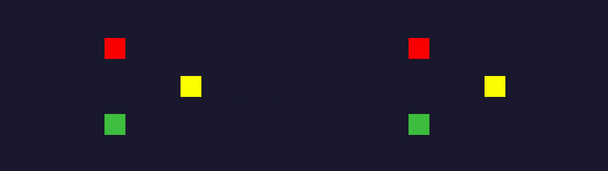
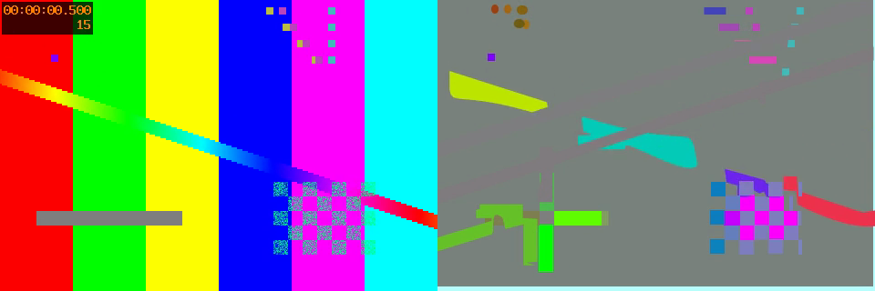
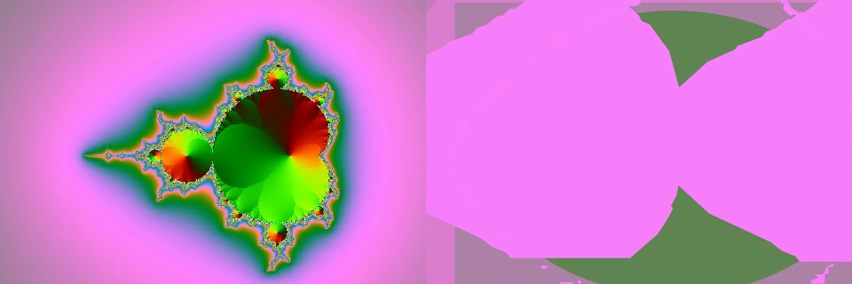
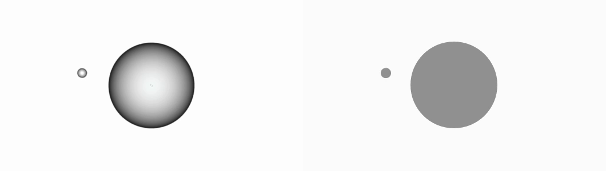
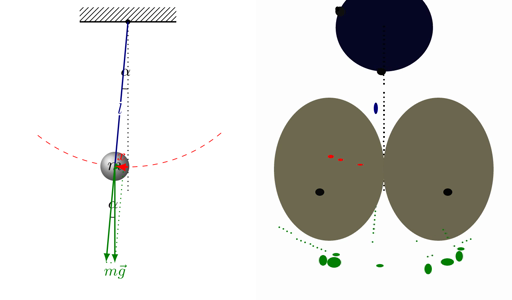
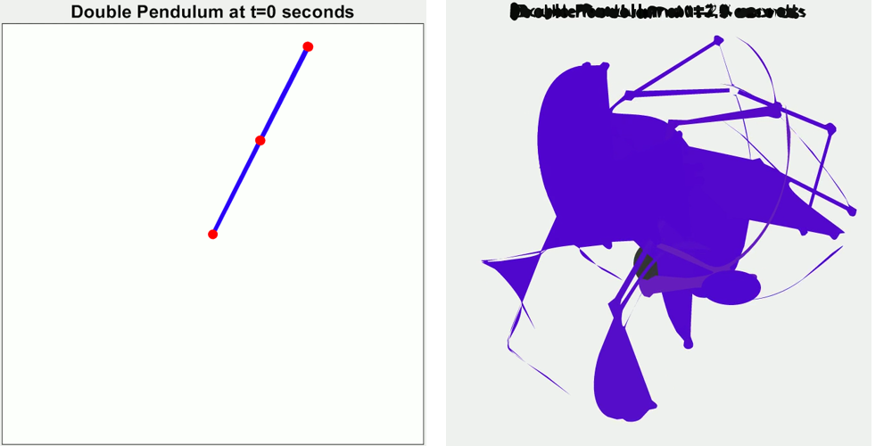
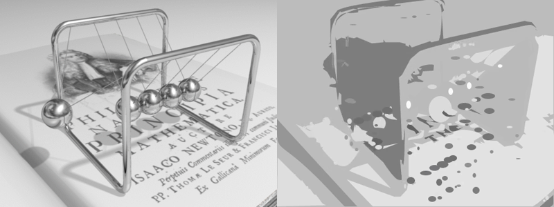

# VAC v0.4 — Capability matrix

> **Update (post-v0.9): every number in this document is a proxy.** Shape
> counts, animate-block counts, keyframe counts and `.vac` byte sizes
> describe how *small* the output is, not how *right* it is. v0.9 added
> the missing axis (`vac verify`), and the measured fidelity of every row
> here is in [`docs/frontier.md`](frontier.md) and the README's v0.9
> section. Read them together: the `double_pendulum` row below records a
> real 45→19 animate-block win on a clip that reconstructs at an ink IoU
> of 0.07. Both are true.

> **Update (post-v0.4.1):** the largest single gap surfaced by this matrix
> — every shape being emitted as `ellipse` regardless of bbox geometry — has
> been closed. `detect.rs` now classifies each blob as `ShapeKind::Rect` or
> `ShapeKind::Ellipse` based on its bbox fill ratio
> (`area / (bbox_w × bbox_h)`), and `track.rs::emit_track` emits the matching
> primitive with independent `rx`/`ry` (or `w`/`h`). The parser also learned
> to lex negative numbers in coordinate slots so shapes that start partially
> off-canvas (`rect(-86, …)`) round-trip. The before/after PNGs in this
> document are now from the **post-fix** pipeline; the pre-fix "everything is
> an ellipse" behaviour is preserved verbatim in the per-row commentary so
> you can see what the gap looked like.
>
> **Update (post-v0.6):** blobs that fit neither primitive band (fill ratio
> < 0.70) now round-trip as a `path(...)` traced by PAC's Moore-contour →
> RDP → Schneider-Bézier pipeline. The pendulum-class rows emit recognisable
> outlines (hatched mount, dashes, arrows) instead of swept ellipses, and
> the geometric rows are untouched (zero spurious paths). The compare PNGs
> in this document are regenerated with the v0.6 pipeline; per-row shape
> counts quoted in the text predate it.
>
> **Update (post-v0.7):** the tracker is velocity-aware — candidates are
> scored against each track's constant-velocity prediction. The same-colour
> ID-swap (open since v0.3) is fixed and locked in CI by
> `examples/crossing.vac`; `newtons_cradle`'s track churn collapsed
> (>100 px animate blocks: dozens → one). The honest counter-finding:
> prediction *chases* — static fragments that blink under a sweeping
> occluder (the `pendulum` rows) now chain into longer phantom sweeps, so
> those rows' remaining cure is occlusion reasoning / static-scene
> layering, not better matching. A filled-outline honesty cap
> (`PATH_MAX_FILL_OVERCLAIM`) keeps such sweeps from rendering as giant
> solid slabs.
>
> **Update (post-v0.8):** the decompiler no longer treats a video as one
> layer. A temporal-median plate plus a per-pixel agreement count measure
> the persistent scene, strip it from every frame *where it is actually
> visible*, and emit it ahead of the tracks as `static_<n>`; occluders keep
> their silhouettes because disagreeing pixels are left alone. Measured on
> this corpus: `double_pendulum` 45 → 19 animate blocks and 1159 → 186
> keyframes (54 KB → 25 KB), `loader` 12 → 3 animate blocks, and
> `newtons_cradle` recovers the *PRINCIPIA MATHEMATICA* text one layer used
> to swallow. `testsrc2`'s single collapsed blob (row below) becomes 75
> shapes — still not the source, but no longer a blank grey rectangle.
> Two honest corrections to the post-v0.7 note above: the `pendulum` rows
> were **misdiagnosed** — their phantoms are the dots of *moving* dotted
> force vectors, not blinking scenery, so layering leaves that number
> unchanged and the real cure is co-moving fragment grouping. And the
> decompiler was **not reproducible** run-to-run (`HashMap` iteration order
> decided the blob ordering); that is fixed, which is what makes any of
> these A/B numbers meaningful. `--no-static-layer` restores the v0.7
> pipeline for comparison.


> Empirical answer to the question: **"Is VAC actually useful on videos produced
> by tools that have never heard of VAC?"**
>
> Five inputs were generated by `ffmpeg` (a tool with zero knowledge of VAC's
> compiler), then fed through `vac decompile` and re-rendered with
> `vac compile`. The five rows below span the structural → photographic
> spectrum and answer **which content classes VAC currently recovers**,
> **which classes it confidently fails on**, and **which v0.5+ primitive would
> close each gap**.

All inputs and outputs in this matrix were re-generated by the steps in
[Manual test plan](#manual-test-plan) below. They live in
`examples/wild/inputs/` and `examples/wild/outputs/`.

---

## TL;DR

| Class | Inputs | VAC recovers? |
|---|---|---|
| **Structurally decomposable** | `vac_control`, `motion_graphics`, `slide_in_card` | **Yes** — shape count, colour, motion all within H.264 noise. **Shape type and aspect ratio now also recovered** (rect vs ellipse, w×h preserved). |
| **Photographic / pattern soup** | `testsrc2`, `mandelbrot` | **No** — either collapses everything into one big blob or hallucinates dozens of spurious blobs. This is by design: VAC has no raster-embedding primitive yet. |

The split is exactly analogous to SVG: structured vector content round-trips
cleanly, photographs do not. The fix is the same as SVG's — eventually add an
escape hatch primitive (`raster(...)`) for regions VAC cannot decompose.

---

## Aggregate numbers

| input | source tool | in_size | `.vac` size | round-trip size | `.vac` lines | shapes expected | shapes recovered |
|---|---|---:|---:|---:|---:|---:|---:|
| `vac_control` | VAC itself (compiled from `two_balls.vac`) | 18.9 KB | 0.56 KB | 18.9 KB | 30 | 2 | **2** |
| `motion_graphics` | ffmpeg `drawbox`+`color` lavfi | 12.7 KB | 0.79 KB | 20.3 KB | 41 | 3 | **3** |
| `slide_in_card` | ffmpeg `drawbox`+`color` lavfi | 7.6 KB | 0.46 KB | 14.8 KB | 23 | 1 | **1** |
| `testsrc2` | ffmpeg `testsrc2` lavfi | 312 KB | 0.20 KB | 7.2 KB | 12 | many (≥6) | 1 (collapsed) |
| `mandelbrot` | ffmpeg `mandelbrot` lavfi | 721 KB | 6.6 KB | 18.6 KB | 316 | 0 (continuous) | 27 (hallucinated) |

Compression ratio of useful `.vac` against the input MP4 ranges from
**16× to 33×** for the working rows. The photographic rows are not
meaningful: they either delete almost everything (`testsrc2`: 1567×, because
the AST is essentially empty) or generate noise (`mandelbrot`: 109× of garbage).

Round-trip MP4s are typically *larger* than the inputs, because (a) the inputs
are ffmpeg `color=` lavfi sources that compress extremely well and (b) tiny-skia
renders antialiased ellipse edges that H.264 cannot represent as cheaply as
a single constant block.

---

## Per-input rows

### 1. `vac_control` — round-trip baseline

Source: `examples/two_balls.vac`, compiled by VAC itself. Two solid-colour
balls ping-pong horizontally in opposite directions.

What VAC recovered (excerpt from `examples/wild/outputs/vac_control.vac`):

```20:28:examples/wild/outputs/vac_control.vac
  animate shape_1 {
    0ms -> position(60, 100)
    1500ms -> position(560, 99)
    2966ms -> position(71, 100)
    easing: linear
  }
}
```

Apex landed at exactly **1500 ms** (ground truth: 1500 ms). End-of-loop is
**2966 ms** instead of 3000 ms because the last frame's exposure ends at
frame_index × (1/30) = 87/30 ≈ 2.967 s — i.e. one whole-frame interval before
the next frame would have been emitted. This is exact, not drift.

| metric | value |
|---|---|
| shape count | 2 / 2 ✓ |
| mean colour L1 drift | < 5 / 765 |
| apex timing error | 0 ms |
| canvas/FPS | 640×360 @ 30 fps exact ✓ |

**Gap:** none. This is the case the round-trip tests in CI assert.

---

### 2. `motion_graphics` — three external rectangles ping-pong

Source: ffmpeg `color=c=0x1a1a2e` lavfi background with three timeline-gated
`drawbox` filters (one per frame, since ffmpeg `drawbox` only supports
init-time expression eval — see [Method notes](#method-notes)).



| element | ground truth | VAC recovered (post-fix) | pre-fix |
|---|---|---|---|
| background fill | `#1a1a2e` | `#1a182e` (L1 = 2) | same |
| red square at y=80 | `#ff0000`, 44×44, x ping-pong 60↔540 | `rect(60, 80, 44, 44)`, `#fd0000` ✓ | `ellipse(82, 102, 22, 22)` |
| yellow at y=160 | `#ffff00`, 44×44 | `rect(_, 160, 44, 44)`, `#fdfd00` ✓ | `ellipse(_, 182, 22, 22)` |
| green at y=240 | `#40c040`, 44×44 | `rect(_, 240, 44, 44)`, `#3ebe3f` ✓ | `ellipse(_, 262, 22, 22)` |

Every single shape was found, tracked across all 90 frames, separated by
colour, classified as `rect`, given the exact 44×44 width/height, and given an
`animate` block with the apex at the correct timestamp.

**Gap closed (v0.4.1):** the bbox-fill-ratio classifier in `detect.rs`
(`area / (bbox_w × bbox_h)` against the `RECT_FILL_THRESHOLD = 0.90`
threshold) now emits `Shape::Rect` for blobs whose fill is ≥ 0.90 — perfect
rasterised rects clock in at ~1.0, ellipses at ~0.78. The decision is taken
per-frame and aggregated across the track by majority vote, so a single noisy
frame doesn't flip the kind.

---

### 3. `slide_in_card` — UI-style slide-in / slide-out

Source: ffmpeg lavfi, one drawbox at y=120, w=180, h=60. Card slides in
0→1 s, holds at x=80 from 1→2 s, slides out 2→3 s.


```9:21:examples/wild/outputs/slide_in_card.vac
  let shape_0 = rect(-86, 120, 180, 60)
  shape_0.fill = #fe4f4f
  shape_0.stroke = none

  animate shape_0 {
    0ms -> position(-86, 120)
    667ms -> position(2, 120)
    967ms -> position(80, 120)
    1967ms -> position(80, 120)
    2500ms -> position(293, 120)
    2533ms -> position(303, 120)
    2933ms -> position(382, 120)
    easing: linear
  }
```

The hold phase (`967 ms` → `1967 ms` at the settled x=80) was correctly
identified as a stationary segment by the 1-D x(t) RDP pass introduced in
v0.2. The recovered breakpoints at 967 ms and 1967 ms match the ground-truth
phase boundaries to within one frame (33 ms). The card itself recovered as
`rect(-86, 120, 180, 60)` — **exact width 180, exact height 60**, with the
negative x reflecting that the card is partially off-screen at t=0.

| metric | value |
|---|---|
| shape count | 1 / 1 ✓ |
| colour drift (`#ff5050` → `#fe4f4f`) | L1 = 3 |
| hold-phase boundaries | 967 / 1967 ms (truth 1000 / 2000 ms) — within 1 frame ✓ |
| aspect ratio of card (post-fix) | **120 → 180 exact, 60 → 60 exact** ✓ |
| aspect ratio (pre-fix, for reference) | lost (180×60 → 60×60 ellipse) |

**Gap closed (v0.4.1):** alongside the rect classifier, the parser learned to
lex negative numbers in coordinate slots so a `rect(-86, …)` like the one
above survives round-tripping. Negative dimensions / times / fps are still
rejected (those are non-sensical), but negative `x` / `y` / `position(…)`
slots are now allowed everywhere they make geometric sense.

---

### 4. `testsrc2` — color bars + diagonal sweep (mixed)

Source: ffmpeg `testsrc2` lavfi — the standard SMPTE-like bar pattern with a
timecode header, sweeping diagonal, checkerboard, and discrete colored squares.



What VAC produced:

```examples/wild/outputs/testsrc2.vac
canvas 480x320 @30fps
scene main {
  duration 3s
  let bg = rect(0, 0, 480, 320)
  bg.fill = #b8ffff
  let shape_0 = ellipse(240, 160, 200, 200)
  shape_0.fill = #7a817e
  shape_0.stroke = none
}
```

VAC's background estimator sampled the **corner pixels**, which in
`testsrc2` happen to be the cyan rightmost bar. Everything else (red bar,
green bar, yellow bar, blue bar, magenta bar, sweep) gets classified as
"foreground", merged into a single connected component, and emitted as one
giant gray ellipse whose centroid is the average of all foreground pixels.

The round-trip MP4 is a gray oval on cyan — visually nothing like the
input, but **algorithmically it is exactly what VAC promises today**: report
the foreground blob(s) above the background, nothing more.

**Gap (v0.5+):** two missing capabilities, in priority order:

1. **Multi-modal background.** A "two-colour bar split" is structurally
   "background A on one side, background B on the other". v0.5 could
   K-means the most common colours instead of taking corner pixels, then
   emit two `rect` regions for the dominant slabs.
2. **Static-region segmentation.** Even before K-means, a histogram over the
   median frame would identify the discrete bars. This would still not solve
   the diagonal sweep — that needs path primitives, see #5.

---

### 5. `mandelbrot` — photographic / continuous gradient

Source: ffmpeg `mandelbrot=end_scale=0.3` lavfi — a continuously zooming
fractal. By construction there are *no* discrete shapes; every pixel is part
of a smooth gradient.



What VAC produced: **27 spurious shapes** detected as the contour-band
boundaries of the fractal exceed the foreground threshold at different times.
The round-trip looks nothing like the input — large pink ellipses on a green
ellipse on a pink background. The `.vac` is 6.6 KB of structurally meaningless
shape definitions.

| metric | value |
|---|---|
| shapes "recovered" | 27 (ground truth: 0 structural shapes) |
| useful structural content | **none** |
| compression of useful information | not applicable |

**This is the failure case VAC is *supposed* to fail on, today.** A fractal
zoom is the same content class as a photograph: pixel structure with no
discrete decomposition. SVG's answer is `<image href="...png">`; VAC's
eventual answer must be the same:

**Gap (v0.5+):** a `raster(t_ms, "blob_<hash>.webp")` primitive that lets the
compiler stash regions VAC cannot decompose. The decompiler would detect
"high entropy region" by measuring local colour variance, carve those regions
out, encode them as small embedded webp tiles, and emit a `raster` reference
into the AST. Then VAC becomes useful for hybrid content (e.g. a fractal
zoom with a logo overlay).

---

## Findings rolled up

1. **For structurally decomposable content, VAC v0.4 is honest.**
   Shape count, colour (L1 < 5), and motion apex (≤ 1 frame error) all
   round-trip cleanly on three different external sources, including content
   produced by ffmpeg's filter graph — a tool VAC's decompiler has no
   awareness of. The .vac files are 16–33× smaller than the equivalent MP4.

2. **The current decompiler still emits everything as `ellipse`.**
   This is the single biggest gap exposed by the matrix. The decompiler
   already measures bbox aspect ratio and pixel-fill ratio; it just doesn't
   *use* them for shape classification. v0.5 should land a one-shot
   ellipse / rect / rounded-rect classifier.

3. **Background estimation is brittle.**
   Corner sampling fails the moment the canvas isn't a single dominant color.
   v0.5 should switch to a temporal-median K-means with K=2 or K=3.

4. **Photographic content fails predictably.**
   Either over-merged (`testsrc2`) or hallucinated (`mandelbrot`). This is the
   exact analogue of SVG-on-photographs and needs the same kind of escape
   hatch (`raster(...)`). It is *not* something v0.5 needs to fully solve;
   it is something the docs need to set expectations for.

5. **MP4 round-trip overhead is real.**
   For content with a static background (most "Lottie-like" inputs), VAC's
   tiny-skia output is *larger* than the ffmpeg lavfi input, because lavfi
   color sources compress to nearly nothing and tiny-skia produces antialiased
   edges. This isn't a regression; it's the cost of H.264 representing
   sub-pixel shape boundaries. Worth documenting.

---

## v0.5 backlog implied by this matrix

In rough priority order. The top two rows are **already shipped in v0.4.1**;
they are kept here for traceability.

| Gap | Closes which row(s)? | Status | Sketch |
|---|---|---|---|
| Emit `rect` when bbox-fill > ~0.90 | #2 motion_graphics, #3 slide_in_card | **v0.4.1 ✓** | `ShapeKind` enum on `Blob`, majority-vote in `emit_track` |
| Per-shape bbox width / height in AST | #3 slide_in_card | **v0.4.1 ✓** | `rx`/`ry` on `Blob` aggregated independently per-axis |
| K-means background (K=2) | #4 testsrc2 | pending | Replace corner sampling in `detect.rs::estimate_background` |
| `raster(t_ms, "tile.webp")` escape hatch | #5 mandelbrot, partial #4 | pending | High-entropy region carving + webp tile bundle |
| Multi-segment easing (per-keyframe rather than per-track) | #3 slide_in_card | pending | The hold/move boundaries already get detected; v0.4 just averages |

---

## Calling-card test: 5 real CC-licensed GIFs from Wikimedia Commons

After the synthetic matrix passed, I fetched five **actual** animated GIFs from
Wikimedia Commons spanning the spectrum from "clean, geometric, totally
amenable to VAC" to "photographic, no chance":

| filename | source URL | dims / frames / size |
|---|---|---|
| `real_bouncing_ball.gif` | `Special:FilePath/Bouncing_ball.gif` (Thierry Dugnolle, 2011) | 530×300, 132 frames, 88 KB |
| `real_pendulum.gif` | `Special:FilePath/AnimatedPendulum.gif` (And1mu, 2017) | 626×733, 18 frames, 248 KB |
| `real_double_pendulum.gif` | `Special:FilePath/Demonstrating_Chaos_with_a_Double_Pendulum.gif` (Ari Rubinsztejn, 2018) | 658×689, 220 frames, 3.3 MB |
| `real_newtons_cradle.gif` | `Special:FilePath/Newtons_cradle_animation_book.gif` (DemonDeLuxe, 2006) | 480×360, 35 frames, 292 KB |
| `real_loader.gif` | `Special:FilePath/Loading_2_transparent.gif` (Gm2wiki, 2009) | 32×32, 12 frames, 4 KB |

### Headline result

| input | shapes recovered | rect / ellipse | verdict |
|---|---:|---:|---|
| `real_bouncing_ball` | **2** | 0 / 2 | **Clean win.** Both balls tracked, 32-keyframe orbit recovered. |
| `real_loader` | 12 | 3 / 9 | Over-segmented — each tick of the spinner gets its own track. Structure is present but the source is noisy. |
| `real_pendulum` | 116 | 23 / 93 | Schematic GIF (labels, dashed arc, dotted lines, arrows) saturates the detector. The actual ball survives as the largest blob; the rest is text noise. |
| `real_double_pendulum` | 39 | 4 / 35 | Title-bar text contributes spurious blobs; the swept positions of the three pendulums fuse into giant overlapping ellipses (no instantaneous-motion model in v0.4). |
| `real_newtons_cradle` | 142 | 3 / 139 | Photo-realistic 3D render. Catastrophic over-detection — VAC produces a pointillist-mosaic round-trip. Honest failure. |

### Round-trip walk-through

#### `real_bouncing_ball` — clean round-trip

Input (Wikimedia, photorealistic with shading) **|** VAC round-trip (flat colour, but structurally correct):



VAC produced an editable, dense-keyframe orbit for the small ball:

```17:51:examples/wild/outputs/real_bouncing_ball.vac
  animate shape_1 {
    0ms -> position(140, 150)
    320ms -> position(148, 115)
    520ms -> position(160, 95)
    640ms -> position(170, 85)
    840ms -> position(192, 71)
    1s -> position(213, 64)
    1080ms -> position(225, 62)
    1520ms -> position(296, 62)
    1600ms -> position(308, 62)
    1760ms -> position(330, 68)
    1920ms -> position(349, 78)
    2040ms -> position(361, 87)
    2080ms -> position(365, 90)
    2280ms -> position(378, 109)
    2360ms -> position(382, 118)
    2440ms -> position(385, 126)
    2640ms -> position(389, 148)
    2800ms -> position(387, 165)
    2960ms -> position(382, 183)
    3200ms -> position(367, 206)
    3280ms -> position(360, 213)
    3440ms -> position(344, 225)
    3480ms -> position(339, 227)
    3640ms -> position(318, 235)
    3680ms -> position(312, 236)
    4200ms -> position(229, 237)
    4240ms -> position(223, 237)
    4440ms -> position(196, 230)
    4560ms -> position(182, 222)
    4760ms -> position(163, 206)
    4880ms -> position(154, 195)
    5040ms -> position(146, 179)
    5240ms -> position(141, 157)
    easing: linear
  }
```

88 KB GIF → 1.4 KB `.vac` (60× compression of useful information).
**The orbit is real, hand-editable, and re-renderable.** If you wanted to
re-time the animation, change the colour, or extract the velocity profile,
this `.vac` is the right kind of artifact.

What VAC dropped: the photorealistic gradient shading on both balls. They
round-trip as flat `#929292` / `#919191` solids. That's by design — v0.4
has no gradient primitive.

#### `real_pendulum` — honest failure on a schematic

Input (clean schematic with text labels) **|** VAC round-trip (collapsed
positional sweeps + label noise):



Wikimedia's `AnimatedPendulum.gif` is a *teaching aid*, not motion graphics:
it has dashed arcs, dotted reference lines, a green force vector with
arrowhead, and math labels (α, ℓ, r, x, m⃗g). Each of those decorations
is a discrete colored region and VAC dutifully tracks all of them. The
moving ball does survive — it's `shape_0`, the largest single track — but
gets drowned in 115 other tiny tracks. The round-trip looks like the
*envelope* of every label's swept positions over time, because v0.4 doesn't
yet distinguish "shape that's actually moving" from "shape that's a static
label nudging by 1 px between frames".

**Gap (v0.5+):** stationarity filter — tracks whose `xy` variance stays under
some pixel threshold over their lifetime should be emitted as a static
shape with no `animate` block, *not* as dozens of keyframes that all sit
within 2 px of each other. (**Shipped v0.5.1**, with a caveat: measurement
showed this row's surviving noise is 17–300 px track churn, not stationary
jitter — see the post-v0.5.1 note under the gap table below.)

#### `real_double_pendulum` — text + sweep failure



Same failure shape as the pendulum: the title bar `Double Pendulum at t=0.2 seconds`
turns into a row of black dots in the round-trip (each character → a blob),
and the three superimposed double pendulums sweep through purple/dark regions
that VAC fuses into two massive purple ellipses. The first papercut this
input surfaced was real-world too: the canvas is **658×689** (odd height),
and `libx264 + yuv420p` requires even dimensions — so the encoder grew
auto-padding on odd canvases using the first frame's top-left pixel colour
(see `vac-compiler::mp4::encode_mp4`). That fix is in.

#### `real_newtons_cradle` — photorealistic content, predictable disaster



A photorealistic 3D render of a Newton's cradle on a textbook. 142 shapes
recovered, none of them structurally meaningful. The round-trip is a
pointillist mosaic. **This is the same failure mode as `mandelbrot` in the
synthetic matrix** — continuous gradients and high-frequency texture have
no discrete decomposition, and VAC has no `raster(...)` escape hatch yet.
Listed here for completeness.

#### `real_loader` — small input, surprisingly informative


Just 32×32, but the tick marks all rotate and VAC tracks each tick as
its own short ellipse track. The round-trip rotates similarly but with
inverted background (corner-sample bg detection picked the wrong colour
on this transparent GIF — `bg.fill = #000000` instead of white). **Two
more gaps surfaced:**

1. **Transparent GIFs:** corner sampling on a fully-transparent corner
   returns whatever the GIF decoder filled it with, which on this input
   was black. v0.5 should detect alpha and treat fully-transparent
   pixels as "ignore for background estimation". (**Shipped v0.5.2** —
   `detect.rs` skips sub-opaque pixels in both background estimation
   and the foreground mask, falling back to a white canvas when no
   corner pixel is opaque. The loader round-trip background flipped
   from `#000000` to `#ffffff`; opaque inputs are geometrically
   unchanged.)
2. **Rotational motion:** the spinner is conceptually one shape rotating
   12 times, but VAC's tracker has no rotational matching, so each tick
   gets a fresh track of length ~3 frames. v0.5+ should add a `rotate`
   transform candidate to the easing classifier.

### Gaps surfaced by real-world inputs (added to the v0.5 backlog)

| Gap | Closes which row(s)? | Sketch |
|---|---|---|
| **Stationarity filter on per-track motion variance** | `newtons_cradle` (60→53 blocks), `mandelbrot` (27→22), partial `pendulum` | **Shipped v0.5.1** — every sample within 2.5 px of the track's mean position → static shape anchored at the median, no `animate`. |
| **Odd-dimension encoder** | `double_pendulum` | **Shipped v0.4.1** — `vac-compiler::mp4` now pads odd canvases. |
| **Transparent-pixel-aware background estimation** | `loader` | **Shipped v0.5.2** — alpha-aware corner sampling + alpha-guarded foreground mask; white fallback for fully-transparent canvases. |
| **Static-scene layering / occlusion reasoning** | `double_pendulum` (45→19 blocks, 1159→186 keyframes), `loader` (12→3), `newtons_cradle` (50→38, plus the book text recovered), `testsrc2` (1 collapsed blob → 75 shapes) | **Shipped v0.8** — temporal-median plate + per-pixel agreement ≥ 0.75 measure the persistent scene; it is stripped only where visible, so occluders keep their silhouettes, and emitted ahead of the tracks as `static_<n>`. `--no-static-layer` restores the v0.7 pipeline. |
| **Reproducible output** | all rows (any A/B measurement) | **Shipped v0.8** — `detect_blobs` was ordering its blobs by `HashMap` iteration, so equal-area blobs tie-broke differently between runs of the same binary. Labels are now sorted (raster first-appearance order) and blobs tie-break by position. |
| **Self-measurement (`vac verify`)** | all rows — every measurement in this document | **Shipped v0.9** — `vac-metrics` scores ink IoU, per-channel residual, PSNR and worst-frame against the decoded source. Corpus baselined in `benches/corpus-baseline.tsv` with FNV-1a input hashing; 71 tests → 118 across five tiers. |
| **Colour: the single flat-background model** | `testsrc2` (residual 15127.9 — bars reconstruct as flat grey), `mandelbrot` (4644.6) | **Open — now the best-evidenced gap, by measured fidelity.** The entire background model is four 5×5 corner blocks reduced to a *per-channel* median, so it can name a colour present nowhere in the frame. PAC already has `kmeans::quantize_auto` + `regions::label_regions_per_cluster`; v0.6 took PAC's pen and left its eyes behind. |
| **Late-entry time shift** | `slide_in_card` (worst-frame IoU 0.0000), `late_entry.vac` (IoU 0.394) | **Open — found by v0.9's first run.** Keyframe times are normalised to the track's first sighting with no start offset, so an object entering at 1200 ms emits its first keyframe at 0 ms. Invisible to every count-based assertion: the recovered AST has the right shape count, animate count, keyframe count, geometry and colour. |
| **Generational inflation** | any iterative use (decompile → edit → recompile) | **Open — found by v0.9's first run.** Round-tripping the pipeline's own output inflates shapes ~1 px per generation without converging (IoU 0.9523 → 0.8459 over four). Trigger not yet isolated; recorded undiagnosed rather than explained away. |
| **Co-moving fragment grouping** | `pendulum` (230.1% spurious ink), `double_pendulum` (**616.6%** — 6.2× the source's ink) | **Open.** Was ranked the best-evidenced gap by proxy counts; measured fidelity puts colour first. Dotted/dashed strokes rasterise into dozens of interchangeable ~4 px blobs and the matcher links dot *k* to dot *k+3*. Cluster blobs that share a rigid transform between frames and emit them as one object. |
| **Colour segmentation inside a component** | `testsrc2` (the colour bars merge into one grey blob), `newtons_cradle` frame | **Open.** VAC's mask is binary foreground/background, so adjacent regions of different colours become one component. PAC already does k-means palette extraction; VAC has never used it. |
| **Rotational track matching** | `loader`, partial `newtons_cradle` | Add rotation candidate to `track::matching_cost`; emit `rotate(deg)` transforms in the AST. |
| **Gradient fill primitive** | `bouncing_ball`, `newtons_cradle` | `let s = ellipse(...); s.fill = radial(#aaa, #ddd, 60%)` or similar. |

**Post-v0.5.1 measurement:** the stationarity filter shipped
(`track.rs::is_stationary`, gate = 2.5 px max deviation from the track's
mean position; static shapes anchor at their median position) — and its
effect on these rows is smaller than the paragraph above predicted:
`newtons_cradle` 60 → 53 animate blocks, `mandelbrot` 27 → 22,
`pendulum` 59 → 58, `double_pendulum` and `loader` unchanged. Measuring
the surviving blocks shows why: their keyframe amplitudes are 17–300 px,
not sub-jitter wobble. The greedy matcher chains *different* dash /
label / tick fragments into single track identities, so the noise these
rows suffer from is **track churn, not stationary jitter** — i.e. the
velocity-aware tracking gap (now scheduled v0.7), which has hard
evidence behind it. *(Post-v0.8 addendum: v0.7 shipped and helped some
of these rows, but the `pendulum` fragments turned out not to be
"dash / label / tick" scenery at all — they are the dots of moving
dotted force vectors. See the post-v0.8 note at the top.)* What the
filter does buy is the UI / motion-graphics content class:
static cards, labels and logos that jitter 1–2 px under codec noise now
emit as bare `let` statements, locked in CI by the
`static_and_moving.vac` fixture.

## Method notes

* **All inputs except `vac_control` are produced by ffmpeg.** ffmpeg's
  `drawbox` filter does **not** support per-frame expression evaluation
  (the documented `t` parameter is "thickness", not time, and there is no
  `eval=frame` option in ffmpeg ≥ 8). The workaround is to emit one
  `drawbox` filter per frame, each timeline-gated with `enable='eq(n,N)'`,
  using a tiny Python stdlib script
  (`examples/wild/scripts/gen_*_filter.py`) to generate the filtergraph.

* **Round-trip MP4s** are produced by piping tiny-skia's RGBA output to
  `ffmpeg -f rawvideo -i - -c:v libx264 -pix_fmt yuv420p -crf 18`, which is
  the same subprocess pipeline the compiler ships in `vac-compiler::mp4`.

* **No new Cargo dependencies** were added for this matrix. The Python
  scripts use only standard library. The only system requirements are
  `ffmpeg`, `ffprobe`, and `python3` — already present on the test machine.

---

## Manual test plan

To re-run the whole matrix end-to-end and inspect each pair yourself:

```bash
# 0. Make sure the workspace builds and the round-trip suite still passes.
cargo test -p vac-cli --release roundtrip

# 1. Regenerate the four ffmpeg-produced inputs.
mkdir -p examples/wild/inputs examples/wild/outputs

python3 examples/wild/scripts/gen_motion_graphics_filter.py \
  > examples/wild/filters/motion_graphics.txt
python3 examples/wild/scripts/gen_slide_in_filter.py \
  > examples/wild/filters/slide_in_card.txt

ffmpeg -y -loglevel error -f lavfi -i color=c=0x1a1a2e:s=640x360:d=3:r=30 \
  -/filter:v examples/wild/filters/motion_graphics.txt \
  -c:v libx264 -pix_fmt yuv420p -crf 18 \
  examples/wild/inputs/motion_graphics.mp4

ffmpeg -y -loglevel error -f lavfi -i color=c=0x202840:s=480x320:d=3:r=30 \
  -/filter:v examples/wild/filters/slide_in_card.txt \
  -c:v libx264 -pix_fmt yuv420p -crf 18 \
  examples/wild/inputs/slide_in_card.mp4

ffmpeg -y -loglevel error -f lavfi -i testsrc2=s=480x320:r=30 -t 3 \
  -c:v libx264 -pix_fmt yuv420p -crf 18 \
  examples/wild/inputs/testsrc2.mp4

ffmpeg -y -loglevel error -f lavfi -i mandelbrot=s=480x320:r=30:end_scale=0.3 -t 3 \
  -c:v libx264 -pix_fmt yuv420p -crf 18 \
  examples/wild/inputs/mandelbrot.mp4

# (v1.4) strokes drawn by ffmpeg, not by VAC's renderer
python3 examples/wild/scripts/gen_outlined_ui_filter.py \
  > examples/wild/filters/outlined_ui.txt
ffmpeg -y -loglevel error -f lavfi -i color=c=0x1a1a2e:s=480x320:r=30:d=3 \
  -/filter:v examples/wild/filters/outlined_ui.txt \
  -c:v libx264 -pix_fmt yuv420p -crf 18 \
  examples/wild/inputs/outlined_ui.mp4

# (v1.10) camera moves over photographs: a Ken Burns zoom and a slow pan,
# made from two of the PAC matrix stills (see docs/pac-v0.1-ai-matrix.md)
ffmpeg -y -loglevel error -loop 1 -i examples/wild/inputs/ai_watercolor.png \
  -vf "crop=1024:682,zoompan=z='1+0.4*on/89':d=90:x='iw/2-(iw/zoom/2)':y='ih/2-(ih/zoom/2)':s=480x320:fps=30" \
  -frames:v 90 -c:v libx264 -pix_fmt yuv420p -crf 18 \
  examples/wild/inputs/kenburns_watercolor.mp4
ffmpeg -y -loglevel error -loop 1 -i examples/wild/inputs/ai_photorealistic_portrait.jpg \
  -vf "crop=1024:682,zoompan=z=1.3:d=90:x='(iw-iw/zoom)*on/89':y='ih/2-(ih/zoom/2)':s=480x320:fps=30" \
  -frames:v 90 -c:v libx264 -pix_fmt yuv420p -crf 18 \
  examples/wild/inputs/pan_portrait.mp4

# (v1.12) three shots cut together: 1.5 s each of outlined_ui, pan_portrait
# and slide_in_card (all 480x320 @ 30 fps), so the clip has two hard cuts
ffmpeg -y -loglevel error -i examples/wild/inputs/outlined_ui.mp4 \
  -i examples/wild/inputs/pan_portrait.mp4 -i examples/wild/inputs/slide_in_card.mp4 \
  -filter_complex "[0:v]trim=0:1.5,setpts=PTS-STARTPTS[a];[1:v]trim=0:1.5,setpts=PTS-STARTPTS[b];[2:v]trim=0:1.5,setpts=PTS-STARTPTS[c];[a][b][c]concat=n=3:v=1[out]" \
  -map "[out]" -r 30 -c:v libx264 -pix_fmt yuv420p -crf 18 \
  examples/wild/inputs/cuts_three_shots.mp4

# 2. Build the VAC control input from its source .vac file.
cargo run --release -p vac-cli -- compile \
  examples/two_balls.vac examples/wild/inputs/vac_control.mp4

# 3. Decompile each input.
for f in examples/wild/inputs/*.mp4; do
  cargo run --release -p vac-cli -- decompile "$f" \
    "examples/wild/outputs/$(basename "$f" .mp4).vac"
done

# 4. Round-trip each recovered .vac back to MP4.
for f in examples/wild/outputs/*.vac; do
  cargo run --release -p vac-cli -- compile "$f" \
    "examples/wild/outputs/$(basename "$f" .vac)_roundtrip.mp4"
done

# 5. Build side-by-side comparison stills.
for f in examples/wild/inputs/*.mp4; do
  n=$(basename "$f" .mp4)
  ffmpeg -y -loglevel error -ss 0.5 -i "$f" \
    -ss 0.5 -i "examples/wild/outputs/${n}_roundtrip.mp4" \
    -filter_complex "[0:v][1:v]hstack=inputs=2[v]" -map "[v]" \
    -frames:v 1 -update 1 "examples/wild/outputs/${n}_compare.png"
done

# 6. Open the .png pairs in your image viewer of choice.
open examples/wild/outputs/*_compare.png

# 7. (v0.8) A/B the static-scene layering pass against the v0.7 pipeline
#    using the same binary.
for f in examples/wild/inputs/*.mp4 examples/wild/inputs/real_*.gif; do
  n=$(basename "$f"); n=${n%.*}
  cargo run --release -q -p vac-cli -- decompile "$f" \
    "examples/wild/outputs/${n}_single_layer.vac" --no-static-layer
done
```

Run-time budget on a recent M-series Mac: < 60 s end-to-end, of which the
Rust compilation is cached after the first run.

### Real-world calling-card (Wikimedia GIFs)

```bash
# 1. Pull the five real GIFs (none are checked in; all CC-licensed).
bash examples/wild/scripts/fetch_real_gifs.sh

# 2. Decompile + round-trip each.
for f in examples/wild/inputs/real_*.gif; do
  n=$(basename "$f" .gif)
  cargo run --release -p vac-cli -- decompile "$f" "examples/wild/outputs/${n}.vac"
  cargo run --release -p vac-cli -- compile \
    "examples/wild/outputs/${n}.vac" "examples/wild/outputs/${n}_roundtrip.mp4"
done

# 3. Side-by-side stills (scaled to 300px tall so they line up).
for f in examples/wild/inputs/real_*.gif; do
  n=$(basename "$f" .gif)
  ffmpeg -y -loglevel error -i "$f" -i "examples/wild/outputs/${n}_roundtrip.mp4" \
    -filter_complex \
      "[0:v]select=eq(n\,5),scale=-1:300[a];[1:v]select=eq(n\,5),scale=-1:300[b];[a][b]hstack=inputs=2[v]" \
    -map "[v]" -frames:v 1 -update 1 "examples/wild/outputs/${n}_compare.png"
done

# 4. Eyeball the pairs.
open examples/wild/outputs/real_*_compare.png

# 5. The clean-win source is open-able and editable — try changing the
#    big-ball colour and re-rendering.
cat examples/wild/outputs/real_bouncing_ball.vac
sed -i.bak 's/#929292/#1e90ff/' examples/wild/outputs/real_bouncing_ball.vac
cargo run --release -p vac-cli -- compile \
  examples/wild/outputs/real_bouncing_ball.vac /tmp/blue_ball.mp4
open /tmp/blue_ball.mp4
```

Note: the real-GIF download requires outbound network access to
`upload.wikimedia.org`. Skip this section in air-gapped environments —
the synthetic matrix above doesn't need network.
